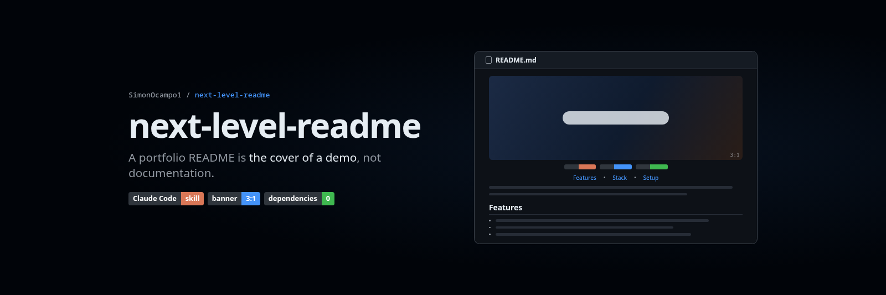

<p align="center">
  
</p>

<p align="center">
  
  
  
  
</p>

<p align="center">
  <a href="#what-it-does"><b>What it does</b></a> &nbsp;•&nbsp;
  <a href="#the-standard">The standard</a> &nbsp;•&nbsp;
  <a href="#the-banner">The banner</a> &nbsp;•&nbsp;
  <a href="#install">Install</a> &nbsp;•&nbsp;
  <a href="#decisions">Decisions</a>
</p>

A Claude Code skill that writes the README of a repo of your own to a fixed standard and draws its banner from the project's own look. It starts from an uncomfortable premise: whoever opens a portfolio repo is not going to maintain it or fork it. They look for thirty seconds and decide whether the project is worth anything. The whole standard follows from that.

## What it does

- **Writes the README from the code, not from the old README.** The details no generic README has are the ones that convince: that the search needs a server because it `fetch`es its index, that the pipeline runs without a GPU in retrieval-only mode.
- **Draws a banner that belongs to the project.** Palette and type come from the real source (a site's `:root`, a TUI's theme, the design system's tokens), and the style comes from the product's medium: a TUI looks like a terminal, a web app like its own hero, a book like its pages.
- **Renders both sizes from one HTML file:** `banner.png` at 1600×533 for the header and `social.png` at 1280×640 for the repo's social preview, the image that shows when the link is shared.
- **Keeps an explicit list of what stays out**, with the reason: Contributing, Roadmap, a table of contents, `build passing` badges, the title repeated under the banner.
- **Bans the words that trip slop detectors:** *seamless, production-ready, robust, cutting-edge*. An adjective you cannot check by looking at the repo goes.

## The standard

```
3:1 BANNER                    the title lives inside it, never repeated below
badges                        right under the banner, stack only
nav row                       Demo • Features • Stack • Structure • Setup
───────────────────────────
intro                         2-3 sentences: what it is, who for, why it exists
## Features                   4-6 bullets, each with the real technical detail
## Stack                      table: layer → technology → why that one
## Structure                  annotated tree, only what matters
## Setup                      copyable bash plus the real gotcha
## Decisions                  optional, 2-3 lines of the non-obvious
```

Reading budget: 90 seconds. If it does not fit, Decisions goes, not Features. The README is written in the project's language.

The mold is [Markdownify](https://github.com/amitmerchant1990/electron-markdownify), an app introducing itself to someone who will look at it rather than maintain it, with the banner-that-holds-the-title of [SDVersion](https://github.com/sebyddd/SDVersion). From [Best-README-Template](https://github.com/othneildrew/Best-README-Template) it takes the centered header and leaves the rest: Roadmap and Contributing are filler in a repo nobody will fork.

## The banner

`banner.html` is the design and a headless Chromium renders it. Nothing new to install: it uses the browser already there.

```bash
# 1. copy the template into the repo, then make it the project's own
cp ~/.claude/skills/next-level-readme/banner.html docs/banner.html

# 2. render both sizes (Linux / macOS)
chromium --headless=new --hide-scrollbars --window-size=1600,533 --screenshot=docs/banner.png docs/banner.html
chromium --headless=new --hide-scrollbars --window-size=1280,640 --screenshot=docs/social.png docs/banner.html
```

On Windows, `make-banner.ps1` does the same and works around two Chromium traps there. `docs/banner.html` stays in the repo as the source, and the PNGs are its output. This repo's banner is drawn in GitHub's own dark theme, because what the skill makes is a README on GitHub.

## Install

```bash
git clone https://github.com/SimonOcampo1/next-level-readme.git ~/.claude/skills/next-level-readme
```

Then, inside Claude Code, `/next-level-readme`. It also triggers on requests like "write the README", "polish the README" or "make the banner".

## Decisions

**3:1, not 16:9.** A 16:9 banner at README width is ~506 px tall: it eats the whole first screen and pushes Features below the fold. The social preview is 2:1, but there the image *is* the whole card.

**One `<p align="center">` per block, with no blank lines inside.** Wrapping everything in one `<div align="center">` works on GitHub, but a blank line closes an HTML block in strict CommonMark and local previewers print the raw tags. The local preview is not the target renderer, so check against the real one without pushing:

```bash
gh api -X POST markdown -f mode=gfm -f text="$(cat README.md)" | head -40
```

**No GIF.** It needs ffmpeg and frame capture. A PNG that convinces beats a GIF that does not.
