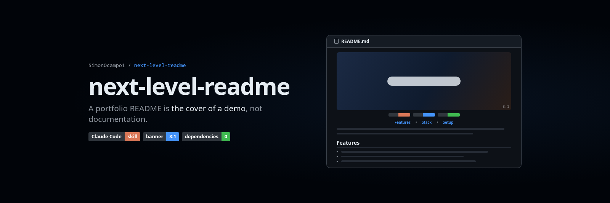

# next-level-readme

El README de un repo de portfolio no es documentación: es **la portada de una
demo**. Quien lo abre no lo va a mantener ni forkear — lo va a mirar treinta
segundos y decidir si el proyecto vale algo. Todo lo que sigue sale de ahí.

Referencias del estándar: [Markdownify](https://github.com/amitmerchant1990/electron-markdownify)
(el molde principal — es una app presentándose, no una librería),
[SDVersion](https://github.com/sebyddd/SDVersion) (banner sin título repetido) y
[Best-README-Template](https://github.com/othneildrew/Best-README-Template)
(del que se toma el header centrado y se descarta el resto).

## La estructura

```
BANNER 3:1                    el título vive adentro — no se repite abajo
badges                        pegados al banner, solo stack
nav row                       Demo • Características • Stack • Estructura • Instalación
───────────────────────────
intro                         2-3 frases: qué es, para quién, por qué existe
## Características            4-6 bullets, cada uno con el detalle técnico real
## Stack                      tabla: capa → tecnología → por qué esa
## Estructura                 árbol comentado, solo lo que importa
## Puesta en marcha           bash copiable + la nota del gotcha real
## Decisiones                 opcional, 2-3 líneas de lo no obvio
```

Header, listo para pegar:

```html
<p align="center">
  
</p>

<p align="center">
  
</p>

<p align="center">
  <a href="https://deploy.vercel.app"><b>Ver el sitio</b></a> &nbsp;•&nbsp;
  <a href="#características">Características</a> &nbsp;•&nbsp;
  <a href="#stack">Stack</a> &nbsp;•&nbsp;
  <a href="#estructura">Estructura</a> &nbsp;•&nbsp;
  <a href="#puesta-en-marcha">Puesta en marcha</a>
</p>
```

**Un `<p align="center">` por bloque, sin líneas en blanco adentro** — el patrón
de Markdownify. La alternativa de envolver todo en un solo `<div align="center">`
con líneas en blanco entre medio también funciona en GitHub, pero una línea en
blanco *cierra* el bloque HTML en CommonMark estricto, así que los previewers
locales (VS Code, el visor de archivos de la terminal) escupen las etiquetas
crudas y no centran nada.

<callout icon="⚠️">
	**El preview local no es el renderer de destino.** Antes de dar por rota la
	maquetación de un README, verificar contra GitHub de verdad:

	```bash
	gh api -X POST markdown -f mode=gfm -f text="$(cat README.md)" | head -40
	```

	Devuelve el HTML exacto que GitHub va a servir, ya sanitizado. Ahí se ve si
	`align="center"` sobrevive y si alguna etiqueta se está escapando. Ojo con
	`gh api`: en Git Bash el endpoint va **sin** barra inicial (`markdown`, no
	`/markdown`), o la shell lo reescribe como ruta de archivo.
</callout>

### Fallback: cuando no hay banner

Si el banner no se puede generar —no hay Chrome ni Edge, el proyecto no tiene
identidad visual propia de la que sacar paleta y tipografías, o simplemente no
llegó a hacerse— el header arranca con el título centrado y grande, y el resto
queda igual:

```html
<h1 align="center">Nombre del Proyecto</h1>

<p align="center">
  
</p>
```

Es un fallback, no una alternativa: un `<h1 align="center">` centrado se lee
como decisión, un `# Título` al ras se lee como plantilla sin terminar. Lo que
nunca va es dejar el README sin encabezado esperando el banner.

## Lo que queda afuera, y por qué

| Descartado | Motivo |
|---|---|
| Contributing, Roadmap, Acknowledgments | Nadie va a contribuir a un repo de portfolio. Son relleno de plantilla OSS. |
| License como sección | Ya está el archivo `LICENSE`, GitHub lo muestra en la barra lateral. |
| Tabla de contenidos | Con seis secciones, el nav row del header ya la reemplaza. |
| Badges de `build passing` / coverage | Sin CI real es decorado vacío, y se nota. |
| Título repetido bajo el banner | Ya está en la imagen. Repetirlo es el error más visible del README default. |
| Pitch en `<h4 align="center">` | Duplica el tagline que ya está dentro del banner y la intro que viene abajo. Tres veces lo mismo en el primer scroll. |
| Screenshot grande del sitio arriba | Con un banner hecho desde la identidad real del proyecto, la captura no agrega nada y duplica el peso del header. Va solo si el producto tiene una UI que el banner no puede mostrar. |

## Tono

El contenido sale de **leer el código**, no el README viejo. Los detalles que
ningún README genérico tiene son los que convencen: que los señaladores se
re-anclan por texto y posición sin tocar el HTML, que el buscador necesita
servidor porque hace `fetch` del índice, que el pipeline corre sin GPU en modo
solo-retrieval. Uno de esos vale más que tres párrafos de presentación.

Prohibido: *high-fidelity, ultra-optimized, seamless, production-ready,
cutting-edge, robust, powerful, comprehensive*. Es el vocabulario que dispara
los detectores de slop, y es el opuesto exacto de lo que el proyecto quiere
transmitir. Un adjetivo que no se puede verificar mirando el repo, sobra.

Idioma: **el del proyecto**, no el del nombre del repo. Si el código y la UI
están en español, el README va en español.

Techo: 90 segundos de lectura. Si no entra, la que sobra es la sección
"Decisiones", no las Características.

## El banner

`banner.html` es el diseño; `make-banner.ps1` lo renderiza a PNG.

```powershell
# 1. copiar la plantilla al repo
Copy-Item ~\.claude\skills\next-level-readme\banner.html docs\banner.html

# 2. editar SOLO el bloque CONFIG de arriba de todo:
#    paleta y fuentes copiadas del :root del sitio real, TITLE y TAGLINE

# 3. renderizar
pwsh -File ~\.claude\skills\next-level-readme\make-banner.ps1 -Src docs\banner.html
```

Salen dos PNG del mismo diseño:

| Archivo | Tamaño | Dónde va |
|---|---|---|
| `banner.png` | 1600×533 (3:1) | header del README |
| `social.png` | 1280×640 (2:1) | repo → Settings → Social preview |

**El social preview no es opcional.** Es la imagen que aparece cuando el link
del repo se comparte en LinkedIn o se pega en un chat; vacío, GitHub pone un
cuadro gris con el nombre de usuario.

**3:1 y no 16:9**: un 16:9 al ancho del README mide ~506 px de alto y se come
el primer scroll entero, empujando las Características abajo del fold. El 2:1
del social preview sí es alto, pero ahí la imagen *es* toda la tarjeta.

El banner se rehace cuando cambia la identidad visual del sitio. `banner.html`
queda versionado en `docs/` justamente para eso: es la fuente, el PNG es la
salida.

### El banner es del proyecto, no de la plantilla

La plantilla es un punto de partida, no el resultado. El banner tiene que
parecer hecho por el mismo proyecto: quien ya vio el producto lo reconoce sin
leer el título. Un banner genérico prolijo (título serif, línea dorada, grilla)
le sirve a cualquier repo, y por eso no le dice nada a nadie de este.

- **Paleta y tipografía, de la fuente real.** El `:root` del sitio, el
  `styles.go` o el theme de una TUI, los tokens del design system. El mismo
  fondo y el mismo acento que ve el usuario. Nunca colores elegidos porque
  quedan lindos.
- **El estilo sale del medio del producto.** Una TUI o un CLI se ven como una
  terminal: fuente pixel o monospace, una línea de prompt con cursor de
  bloque, scanlines. Una web app usa su hero, su grilla y sus componentes. Un
  libro o un sitio editorial usa su tipografía y sus márgenes. Un 3D o un juego
  usa su propio render.
- **Motivos tomados del producto, no inventados.** Hay que escribir la marca
  como la escribe la UI, poner algo de su chrome (la barra de estado, un botón,
  las teclas del footer) y usar su vocabulario real, con los comandos tal como
  se tipean.
- **Si la identidad cambia, el banner se rehace.** Un banner con la paleta
  vieja hace ver el proyecto abandonado aunque tenga commits de ayer.

Ejemplo: `braingent-sto/docs/banner.html`, el banner de una TUI. Tiene un
título en fuente pixel 5×7 dibujada celda por celda, con "brain" en tinta y
"gent" en el acento, como lo escribe la TUI. La paleta sale de `styles.go` y
del grafo. Abajo van un prompt `$ braingent` con cursor de bloque, las teclas
del footer, y la barra `↓0 ↑0 · up to date` en el marco.

### En Linux

`make-banner.ps1` es para Windows. En Linux alcanza con un Chromium por
comando, porque ninguna de las dos trampas de abajo existe. El Chromium de
Playwright sirve si no hay otro, en
`~/.cache/ms-playwright/chromium-*/chrome-linux64/chrome`:

```bash
chromium --headless=new --hide-scrollbars --window-size=1600,533 --screenshot=docs/banner.png docs/banner.html
chromium --headless=new --hide-scrollbars --window-size=1280,640 --screenshot=docs/social.png docs/banner.html
```

Si el diseño mide algo con JS (`innerWidth`), la ventana es la medida, así que
el mismo HTML da las dos composiciones.

### Dos trampas de Chromium headless en Windows

Ambas ya resueltas dentro del script, documentadas para cuando falle algo raro:

1. **Espacios en la ruta rompen `--screenshot` en silencio.** Chromium parte el
   argumento y no escribe nada, sin error y con exit code 0. Por eso el script
   captura a `%TEMP%` y recién después mueve el archivo al destino.
2. **Un GUI app no bloquea la shell.** Lanzarlo desde bash devuelve el control
   al instante y el `ls` siguiente no ve nada. Hace falta
   `Start-Process -Wait`, y por eso el script es PowerShell y no bash.

Brave queda fuera de la lista de navegadores: en headless se cuelga sin escribir
nada ni salir. Chrome y Edge funcionan; Edge viene con Windows.
